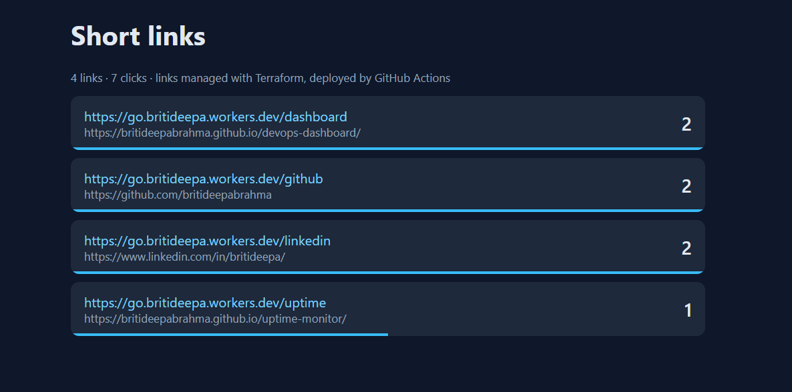
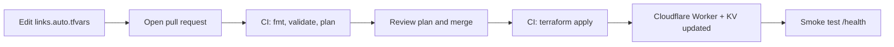
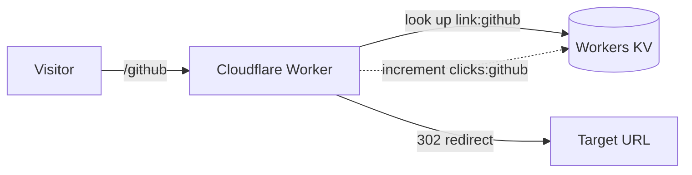

# GitOps URL Shortener

[](https://github.com/britideepabrahma/url-shortener/actions/workflows/terraform.yml)

A serverless URL shortener running on **Cloudflare Workers** and **Workers KV**, where all infrastructure and every short link is defined in **Terraform**. Links are added or removed through pull requests: CI shows the `terraform plan` for review, and merging to `main` applies it automatically.

**Live demo:** https://go.YOUR-SUBDOMAIN.workers.dev



## Features

- **Short links with redirects**, served from Cloudflare's global edge network
- **Click tracking** shown on a public stats page
- **Links as code**: every link lives in [`links.auto.tfvars`](terraform/links.auto.tfvars) and is reviewed like any other code change
- **Input validation** in Terraform: invalid slugs, non-HTTPS targets, and reserved names fail in CI before deployment
- **Plan on pull request, apply on merge**, with a post-deploy smoke test
- **No write API**: links can only be changed through Git, so the public site can't be abused to create spam or phishing links

## How it works





- Terraform creates the KV namespace, one KV entry per link, the Worker script with its KV binding, and enables the `workers.dev` route.
- The Worker looks up `link:<slug>`, redirects to the target, and increments `clicks:<slug>` in the background.
- Terraform state is stored remotely in HCP Terraform; plans and applies run in GitHub Actions.

## Tech stack

| Area | Tools |
|------|-------|
| Runtime | Cloudflare Workers (JavaScript) |
| Storage | Cloudflare Workers KV |
| Infrastructure as Code | Terraform, Cloudflare provider v5 |
| State backend | HCP Terraform |
| CI/CD | GitHub Actions |

## Managing links

Add, change, or remove a line in [`terraform/links.auto.tfvars`](terraform/links.auto.tfvars):

```hcl
links = {
  github    = "https://github.com/britideepabrahma"
  dashboard = "https://britideepabrahma.github.io/devops-dashboard/"
}
```

Then open a pull request. The plan shows exactly what will happen:

| Change | Plan result | Effect |
|--------|-------------|--------|
| Add a line | `1 to add` | New short link goes live |
| Change a target URL | `1 to change` | Same short link, new destination |
| Remove a line | `1 to destroy` | Short link returns 404 |
| Rename a slug | `1 to add, 1 to destroy` | Old short link stops working |

## Project structure

```
url-shortener/
├── worker/worker.js                # Redirects, click counting, stats page
├── terraform/
│   ├── main.tf                     # Provider, state backend, resources
│   ├── variables.tf                # Inputs and validation rules
│   └── links.auto.tfvars           # The short links
└── .github/workflows/terraform.yml # fmt, validate, plan, apply, smoke test
```

## Run your own

1. **Cloudflare** (free plan): create an account, open Workers & Pages once to choose a `workers.dev` subdomain, and note your Account ID.
2. **Cloudflare API token** with only these permissions: Account → Workers Scripts → Edit, and Account → Workers KV Storage → Edit.
3. **HCP Terraform** (free tier): create an organization and a CLI-driven workspace named `url-shortener` with Execution Mode set to **Local**, then create an API token. Put your organization name in `terraform/main.tf`.
4. **GitHub secrets**: `CLOUDFLARE_API_TOKEN`, `CLOUDFLARE_ACCOUNT_ID`, `TF_API_TOKEN`.
5. Push to `main`. After the first deploy, add a repository variable `WORKER_URL` (your Worker address) to enable the smoke test.

## Security

- **Least-privilege API token**: limited to Workers scripts and KV in a single account.
- **Secrets in GitHub Actions secrets**, never in code; the provider reads the token from the environment.
- **Changes require a pull request**: the plan is visible before anything is applied.
- **No public write endpoint**: the only way to create links is through the Git workflow.
- **Output escaping** on the stats page to prevent HTML injection.

## Design notes and limitations

- **Approximate click counts**: Workers KV is eventually consistent, so simultaneous clicks on the same link may be counted once. A Durable Object or database would give exact counts.
- **Free plan limits**: KV allows 1,000 writes per day on the free plan, which caps counted clicks at roughly 1,000 per day. Redirects keep working beyond that.
- **Propagation delay**: new or removed links can take up to about a minute to update worldwide.
- **Click counters are not managed by Terraform**: they're written by the Worker at runtime, so removing a link leaves its counter in KV. It's ignored by the stats page and resumes if the same slug is added again.

## Possible improvements

- Post the `terraform plan` output as a comment on pull requests
- Custom domain for shorter links
- Per-day click history and referrer statistics
- Expiring links using KV expiration